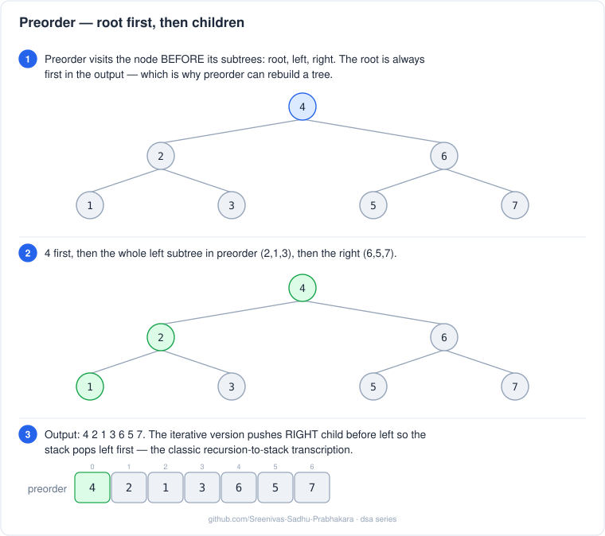

# Binary Tree Preorder Traversal

> Striver SDE Sheet 105 · Day 17 Binary Tree — pop-visit-push with the right child pushed first, so the LIFO order serves the left child next. Go, stdlib only, tested.

## Problem

Visit root → left subtree → right subtree iteratively.

## Approach

Preorder is the easiest traversal to de-recursify because the visit happens *on pop* — no waiting for subtrees. Pop a node, record it, push its children. The one subtlety is push order: the stack is LIFO, so pushing **right before left** makes left come off first, preserving root-left-right. Compare with inorder (#104), where nodes must survive on the stack until their left subtree completes — that asymmetry is why inorder needs the spine-slide and preorder doesn't. Preorder's practical role: it's the order that serializes a tree so it can be rebuilt (#145).

**Complexity:** O(n) time, O(h) stack.

## Visual walkthrough

Read the picture top to bottom — each numbered frame is one moment of the algorithm
running on this repo's test example.

## Run

    go test ./...   # verify
    go run .        # demo

---

One of 191 repos solving Striver's SDE Sheet in Go — stdlib only, one problem per repo, every solution tested. Browse the set: [`dsa-*` repos](https://github.com/Sreenivas-Sadhu-Prabhakara?tab=repositories&q=dsa-&type=source).
